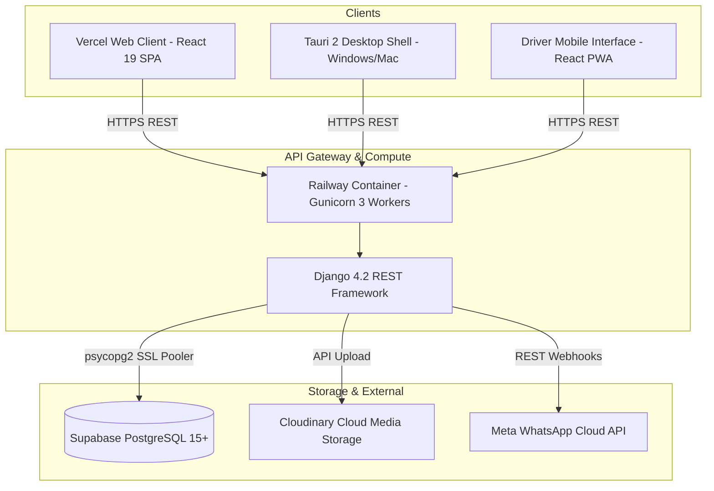

# Zamzam Foods — Current Architecture Specification (`CURRENT_ARCHITECTURE.md`)

> **Document Type:** Production System Audit & Baseline Specification  
> **Source of Truth:** Verified directly against `/Users/shiyasahmad/Documents/zamzam foods` source code  
> **Date of Audit:** October 2026  
> **Authoritative Baseline:** PostgreSQL (Supabase Pooler) + Railway Django REST Backend + Vercel Web + Tauri v2 Scaffolding

---

## 1. System Inventory & High-Level Architecture

The current production system is composed of:
1. **Backend Service (`backend/`)**: Django 4.2.x REST Framework application deployed inside a Debian/Python 3.11 Docker container on Railway, served by Gunicorn (3 workers, 120s timeout) on port 8000.
2. **Database Engine**: PostgreSQL 15+ hosted on Supabase (`aws-0-ap-south-1.pooler.supabase.com:5432/postgres`) using transactional connection pooling (`conn_max_age=600`, `conn_health_checks=True`, SSL required). Local development fallback uses SQLite 3 (`backend/db.sqlite3`).
3. **Web Client (`frontend/`)**: React 19 + TypeScript + Vite 8 Single-Page Application deployed on Vercel Edge (`zamzamfoods.vercel.app`).
4. **Desktop Layer (`frontend/src-tauri/`)**: Tauri 2 (Rust) desktop framework initialized with plugins (`dialog`, `opener`, `log`) and an automated backup worker thread (`src-tauri/src/backup.rs`).



---

## 2. Source Code vs. Documentation Differences

An exhaustive audit of the actual source code versus the existing documentation revealed the following critical discrepancies:

| Topic | Documented State | Actual Source Code Reality | Architectural Impact |
| :--- | :--- | :--- | :--- |
| **Frontend State Management** | Described as modular Redux/Context | Pure React Context (`AuthContext`, `SettingsContext`, `ThemeContext`) + heavy component-local `useState`. No centralized server-state cache. | Every page navigation re-fetches data from scratch; zero global query caching. |
| **Wholesale Entry Architecture** | Described as standard transactional form | Single 7,181-line monolithic component (`CreateOrderPage.tsx`) rendering 150+ shop rows in one un-virtualized DOM table. | Every single cell keystroke re-renders the entire 1,800+ input table, causing severe UI lag. |
| **Local Draft Storage** | Documented as using browser `localStorage` drafts | `draftOrderStorage.ts` explicitly stubbed out (`saveDraft` is empty, `getDraft` returns `null`) to prevent stale Chrome drafts from overriding live database dues. | Local storage drafts are disabled; but stale local storage keys still linger in users' browsers unless explicitly cleared. |
| **Order Deletion & Ledger** | Documented as soft-deletion / cancel status | `OrderViewSet.destroy` physically executes `instance.delete()`, while atomically deducting `current_balance` and logging an `ADJUSTMENT` transaction. | Deleting an order physically deletes the row from `apps_orders_order`. |
| **Desktop Storage Backend** | Mentioned as possible SQLite/Postgres hybrid | Tauri currently only has a backup snapshot downloader in Rust (`backup.rs`), with NO embedded local database engine. The desktop shell simply points to the remote Vite URL or `dist/`. | If the internet goes down, the desktop application loses all read/write capability. |
| **Authentication Cookies** | Described as standard Bearer | Dual-Mode: HttpOnly Cookies (`SameSite=None`, `Secure=True`) + Bearer token header in `localStorage`. | Requires careful CORS and origin configuration (`CORS_ALLOW_CREDENTIALS = True`). |

---

## 3. Database Schema, Models & Migrations Register

The backend maintains 11 domain applications with 18 primary models:

```
backend/apps/
├── accounts/
│   ├── User (AbstractUser, roles: OWNER, MANAGER, DRIVER)
│   ├── DeviceSession (UUID, refresh_token_hash, expires_at, is_active)
│   ├── StaffMember (UUID, role_type: STAFF/MEMBER, wage_type: DEFAULT_SLAB/CUSTOM, custom_daily_wage, joined_date)
│   ├── StaffAttendance (UUID, staff FK, date, status: FULL/HALF/LEAVE, daily_wage)
│   └── StaffPayout (UUID, staff FK, amount, payout_type: SALARY/ADVANCE/BONUS, method: CASH/GPAY)
├── customers/
│   ├── Customer (UUID, name, route FK, credit_limit, current_balance, is_active)
│   ├── CustomerProductPrice (UUID, customer FK, product FK, price, effective_from/to, is_active)
│   └── CustomerDocument (UUID, customer FK, document_type, file, mime_type)
├── orders/
│   ├── Order (UUID, order_number, customer FK, route FK, driver FK, order_date, status, total_amount, shop_expense)
│   ├── OrderItem (UUID, order FK, product FK, quantity, unit_price, subtotal)
│   └── OrderActivityLog (UUID, order FK, action, user_name, user_role, details JSONB)
├── credits/
│   └── CreditTransaction (UUID, customer FK, transaction_type, amount, balance_after, ref_order, ref_payment)
├── payments/
│   └── Payment (UUID, payment_number, customer FK, order FK, amount, payment_method: CASH/GPAY, status: COMPLETED/REVERSED)
├── products/
│   └── Product (UUID, name, code, unit_price, packet_size, order_number, skip_in_entry, is_active)
├── routes/
│   ├── Route (UUID, name, code, description, is_active)
│   ├── Driver (UUID, user OneToOne, assigned_route FK, vehicle_number, license_number, is_active)
│   ├── DriverExpense (UUID, driver FK, category, amount, date, notes)
│   └── DriverShift (UUID, driver FK, date, is_opened, kubbus_loaded, romali_loaded, is_closed, cash_collected)
├── deliveries/
│   └── Delivery (UUID, order OneToOne, driver FK, route FK, status, delivered_at)
├── reports/
│   └── DailyClosing (UUID, date unique, is_opened, opening_cash, is_closed, closed_by, snapshot metrics)
├── common/
│   ├── ActivityLog (UUID, user FK, action, entity_type, summary, details JSONB, timestamp)
│   ├── SystemSettings (Singleton UUID, business info, feature flags, PIN code: 7667)
│   └── BusinessDocument (UUID, title, document_type, file, document_number)
└── whatsapp/
    ├── WhatsAppAccount (UUID, phone_number_id, display_phone_number, waba_id, access_token)
    ├── WhatsAppCustomer (UUID, customer FK, wa_phone, display_name)
    ├── WhatsAppConversation (UUID, account FK, customer FK, unread_count, last_message_at)
    └── WhatsAppMessage (UUID, conversation FK, wamid, direction: INBOUND/OUTBOUND, message_type, content, status)
```

---

## 4. Complete Existing API Endpoint Catalog

All endpoints are prefixed under `/api/v1/` and routed through `config/urls.py`:

### Authentication & Sessions (`apps.accounts`)
* `POST /auth/login/` & `POST /auth/token/`: Password login; sets HttpOnly JWT cookies + returns tokens & user profile.
* `POST /auth/refresh/` & `POST /auth/token/refresh/`: JWT access token refresh using cookie or body refresh token.
* `POST /auth/logout/`: Blacklists active refresh token and clears HttpOnly authentication cookies.
* `GET /auth/me/`: Returns authenticated user profile, permissions, and active route assignments.
* `GET /auth/sessions/` & `DELETE /auth/sessions/<uuid:session_id>/`: Lists and revokes multi-device refresh sessions.
* `CRUD /users/`: Owner-only management of system login accounts.
* `CRUD /staff/`: Management of worker and share-partner profiles.
* `CRUD /staff-attendance/`: Daily attendance logging with automatic tenure-slab wage computation.
* `GET /staff-attendance/daily-sheet/?date=YYYY-MM-DD`: Daily consolidated attendance sheet across all staff.
* `POST /staff-attendance/bulk-save/`: Atomic bulk attendance saving.
* `CRUD /staff-payouts/`: Logging of cash advances, wage payouts, and bonus vouchers.

### Customers & Pricing (`apps.customers`)
* `CRUD /customers/`: Master customer shop CRUD, search by name/phone, filtering by route.
* `GET /customers/balances-for-date/?date=YYYY-MM-DD`: Dynamic calculated opening balance rollback per shop.
* `GET /customers/<uuid:id>/pricing/`: Retrieves effective product pricing matrix for customer.
* `POST /customers/<uuid:id>/pricing/`: Configures or resets shop-specific negotiated wholesale product prices.
* `GET /customers/<uuid:id>/summary/`: Financial overview of customer (total orders, payments, current balance).
* `POST /customers/<uuid:id>/set-balance/`: Owner/Manager direct balance reset with audit log.
* `POST /customers/batch-upload/`: Bulk customer shop import.
* `CRUD /customer-documents/`: Upload and retrieval of customer KYC, food licenses, and store photos.

### Orders & Fast Entry (`apps.orders`)
* `CRUD /orders/`: Order listing with date, route, status filters; transactional creation and updates.
* `POST /orders/<uuid:id>/reopen/`: Manager/Owner reopening of locked orders with audit reason.
* `GET /orders/<uuid:id>/activity/`: Audit trail of order lifecycle events.
* `GET /public/customer-order/<uuid:customerId>/`: Public unauthenticated portal for store self-ordering.
* `POST /public/customer-order/<uuid:customerId>/submit/`: Public order submission with duplicate debounce.

### Payments & Collections (`apps.payments`)
* `GET /payments/`: Historical payment records with date range, route, and collector filters.
* `POST /payments/`: Standard payment recording (creates Payment and CreditTransaction).
* `POST /payments/<uuid:id>/reverse/`: Mandatory audit reversal of payments, restoring customer debt.
* `GET /payments/daily-summary/?date=YYYY-MM-DD`: Aggregated Cash vs UPI collections for current day.
* `POST /payments/sync-daily-payment/`: **Fast Wholesale Entry synchronizer** (upserts Cash & GPay without duplicates).

### Credit Ledger (`apps.credits`)
* `GET /credits/`: Read-only historical ledger entries with running `balance_after`.
* `POST /credits/adjust/`: Authorized Manager/Owner balance adjustments with audit logging.

### Routes, Drivers & Operations (`apps.routes`, `apps.deliveries`)
* `CRUD /routes/`: Delivery territories and route codes.
* `CRUD /drivers/`: Driver profile linking and vehicle registration.
* `GET /drivers/my_profile/`: Authenticated driver profile and vehicle info.
* `CRUD /expenses/`: Operational vehicle, shop, fuel, and food expenses.
* `CRUD /driver-shifts/`: Morning stock loading and evening return reconciliation.
* `GET /driver-shifts/today/`: Today's shift record for authenticated driver.
* `GET /driver-shifts/summary/`: Shift metrics summary (loaded, returned, sold, collections).
* `POST /driver-shifts/open_day/`: Driver morning route shift open with loaded crates.
* `POST /driver-shifts/close_day/`: Driver evening shift close with returns and collections.
* `CRUD /deliveries/`: Delivery dispatch status updates.
* `POST /deliveries/<uuid:id>/complete/`: Marks delivery as completed.
* `POST /deliveries/<uuid:id>/mark-not-delivered/`: Marks delivery failed with reason.
* `POST /deliveries/<uuid:id>/assign-driver/`: Assigns delivery to driver.

### WhatsApp Operations (`apps.whatsapp`)
* `GET & POST /api/whatsapp/webhook/` (and `/api/v1/whatsapp/webhook/`): Meta Cloud API webhook verification & receiver.
* `GET /api/v1/whatsapp/conversations/`: Lists customer chat conversations.
* `GET /api/v1/whatsapp/conversations/<uuid:pk>/`: Conversation detail and unread counter reset.
* `GET /api/v1/whatsapp/conversations/<uuid:pk>/messages/`: Message history.
* `GET /api/v1/whatsapp/customer/<uuid:customer_id>/`: Resolves or initializes conversation for customer.

### Reports & Daily Closing (`apps.reports`)
* `GET /reports/dashboard/`: Role-aware metrics (Driver, Manager, Owner) across date presets.
* `GET /reports/outstanding-credit/`: Aging bucket analysis (0-7d, 8-15d, 16-30d, 30+d).
* `GET /reports/collections/`: Detailed collection log with payment method and collector.
* `GET /reports/driver-collections/`: Aggregated revenue per delivery van.
* `GET /reports/financial-summary/`: Daily P&L summary (Gross Sales vs Expenses vs Net Margins).
* `GET /reports/daily-closing/?date=YYYY-MM-DD`: Real-time operational figures and day status.
* `POST /reports/daily-closing/`: Formal closing submission with verification checklist.
* `POST /reports/daily-closing/reopen/`: Owner-only reopening of closed operational days.
* `POST /reports/daily-open/`: Formal day opening with register cash float recording.

### System, Backup & Common (`apps.common`)
* `GET /settings/` & `PUT /settings/`: Singleton company profile, feature toggles, maintenance switch.
* `POST /settings/verify-pin/`: Verifies 4-digit security PIN (`7667`) for sensitive settings access.
* `POST /settings/reset-pin/`: Admin password-verified PIN reset override.
* `GET /database/stats/`: Live table row counts and PostgreSQL database byte sizes.
* `GET /database/backup/?format=sql|json&type=full`: Streaming export of PostgreSQL SQL or JSON backup.
* `POST /database/restore/`: Transactional import and execution of `.sql` or `.json` backup file.
* `POST /database/clear-all/`: Dangerous operation clearing transactional data (requires `CONFIRM-CLEAR-ALL-DATA` and PIN).
* `GET /api/health/`: Public health check returning system timestamp and DB connectivity status.

---

## 5. Existing Frontend Architecture & Performance Bottlenecks

### 5.1 Component Tree & Page Routing
Frontend navigation is managed by React Router v7 (`AppRoutes.tsx`) inside three role-based layouts:
* `OwnerLayout`: Desktop sidebar navigation with 18 sub-pages.
* `ManagerLayout`: Focused operational sidebar (`CreateOrderPage`, `OrdersPage`, `DailyClosingPage`, `Customers`).
* `DriverLayout`: Bottom-bar mobile navigation for delivery drivers.

### 5.2 Critical Performance Bottlenecks

#### Bottleneck 1: The Monolithic `CreateOrderPage.tsx` (7,181 Lines)
* **Problem**: The entire fast order-entry grid, keyboard handler, inline customer creation modal, price editor modal, WhatsApp share dialog, invoice preview, and table footer are implemented in a single file with over 60 component-level `useState` hooks.
* **Impact**: Whenever any character is typed in any quantity cell (`handleCellChange`), `setRows((prev) => prev.map(...))` triggers a complete re-render of the entire 7,181-line component. For 150 customer rows with 12 input columns, this constructs over **1,800 DOM nodes per keystroke**, resulting in severe input latency and occasional browser tab crashes on office PCs.

#### Bottleneck 2: Lack of DOM Virtualization
* **Problem**: All 150+ customer rows are rendered simultaneously into the HTML table.
* **Impact**: High memory footprint and DOM thrashing during scrolling and search filtering.

#### Bottleneck 3: Hard Full-Page Reloads (`window.location.reload()`)
Audited locations triggering full-page browser teardown:
* `DatabaseStorageBackupSection.tsx` (Line 1952 & Line 2044): Invokes `window.location.reload()` after database restore or clear-all.
* `MaintenanceScreen.tsx` (Line 20 & Line 170): Invokes `window.location.reload()` on refresh and `window.location.href = '/login'`.
* `WebsiteCacheVersionSection.tsx` (Line 149): Invokes `window.location.href = window.location.pathname + '?reload=' + Date.now()`.
* `CustomerOrderPage.tsx` (Line 305): Invokes `window.location.reload()` on submit retry.
* **Impact**: Destroys the native application feel, clears in-memory React state, creates a 2–3s blank white flash, and re-executes all container network handshakes.

#### Bottleneck 4: Unnecessary API Calls & Redundant Operations
* `draftOrderStorage.saveDraft()` is called on every keystroke in `CreateOrderPage.tsx` (line 1327) even though localStorage draft persistence has been explicitly disabled.
* Redundant initial waterfalls: Date switching triggers multiple independent `Promise.all` calls across orders, payments, closing, and opening balances without client-side caching.
* Settings and Profile refetches occur on every route change rather than being cached in server-state.

---

## 6. Existing Financial Calculation & Ledger Synchronization Logic

### 6.1 Order Total Calculation (`orders/services.py`)
```python
subtotal = (Decimal(quantity) * unit_price).quantize(Decimal("0.01"))
total_amount = max(Decimal("0.00"), sum_subtotals - shop_expense).quantize(Decimal("0.01"))
```

### 6.2 Customer Credit Ledger Synchronization
* When an order is created, `record_credit_sale_service` records a `CREDIT_SALE` entry:
  $$\text{customer.current\_balance} \leftarrow \text{customer.current\_balance} + \text{order.total\_amount}$$
* When an order is edited, `update_order_service` updates the existing `CREDIT_SALE` transaction **in-place**:
  $$\text{delta} = \text{new\_total} - \text{old\_total}$$
  $$\text{customer.current\_balance} \leftarrow \text{customer.current\_balance} + \text{delta}$$
  $$\text{sale\_tx.amount} \leftarrow \text{sale\_tx.amount} + \text{delta}$$
  $$\text{sale\_tx.balance\_after} \leftarrow \text{sale\_tx.balance\_after} + \text{delta}$$
* This in-place mutation prevents ghost `ADJUSTMENT` entries from distorting historical previous dues.

### 6.3 Customer Opening Balance Rollback Engine (`customers/services.py`)
To dynamically render the previous due for date $D$ without rewriting history:
$$\text{Opening Due}(c, D) = \text{current\_balance}(c) - \sum_{\text{Orders} \ge D} \text{total} + \sum_{\text{Payments} \ge D} \text{amount} - \sum_{\substack{\text{Standalone Adjs} \ge D \\ \text{ref\_order IS NULL}}} \text{amount}$$
Stand-alone balance adjustments (`ref_order IS NULL`) are included; order-edit adjustments are excluded to avoid double deduction.

---

*Verified against active repository on October 7, 2026.*
