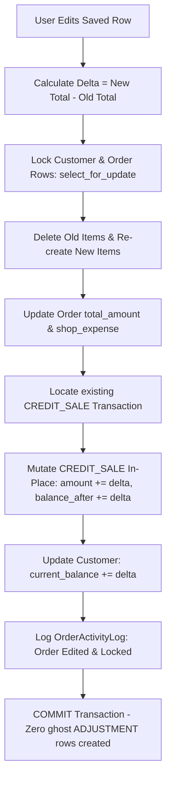
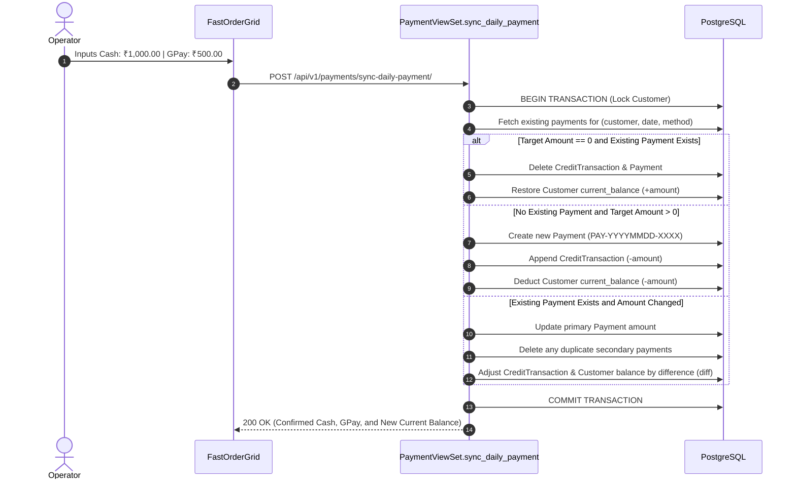
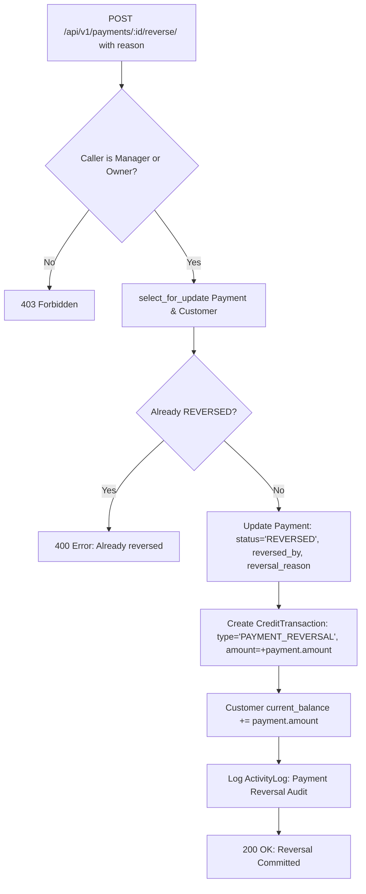
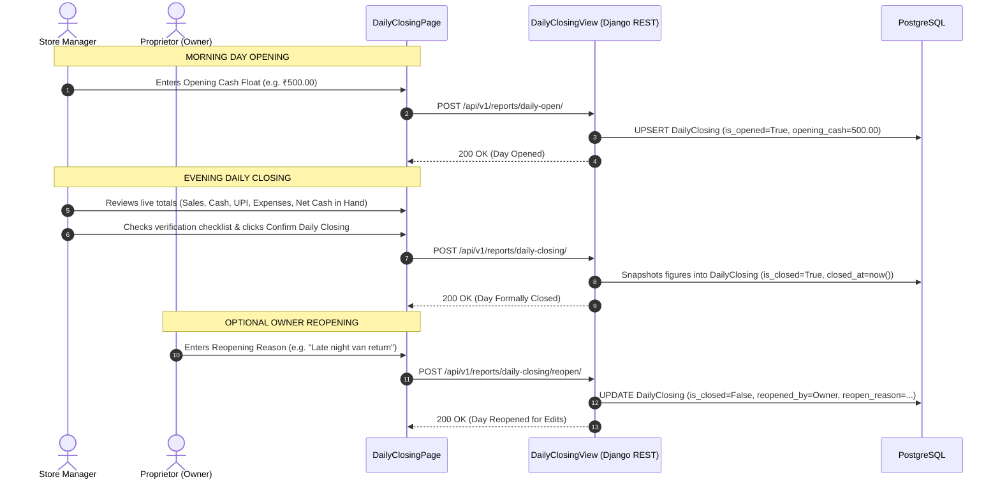
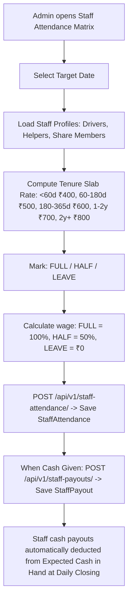

# Zamzam Foods — Comprehensive Data Flow Specification (`DATA_FLOW.md`)

> **Document Type:** Operational Data Flow & Transaction Lifecycle Specification  
> **Scope:** End-to-end data paths for Orders, Payments, Ledgers, Attendance, Daily Closing, and Disaster Recovery  
> **Source of Truth:** Verified against backend services (`apps/*/services.py`) and frontend mutations

---

## 1. Master Order Lifecycle & Transaction Flow

The sales order is the primary business record in Zamzam Foods. The order flow guarantees financial consistency, atomic ledger generation, and idempotency.

### 1.1 Order Creation Sequence Diagram

```mermaid
sequenceDiagram
    autonumber
    actor Operator as Billing Operator
    participant UI as FastOrderGrid (Tauri / Web)
    participant Hook as useCreateOrder (TanStack Mutation)
    participant API as OrderViewSet (Django REST)
    participant Service as create_order_service (Python)
    participant DB as PostgreSQL 15 (Supabase)
    participant Ledger as Credit Ledger (apps.credits)

    Operator->>UI: Types Quantities (100 Kubbus, 10 Romali) -> Hits Enter
    UI->>Hook: mutate({ customerId, orderDate, items, discount })
    Hook->>API: POST /api/v1/orders/
    API->>Service: create_order_service(...)
    Service->>DB: BEGIN TRANSACTION
    Service->>DB: SELECT * FROM apps_customers_customer WHERE id = ... FOR UPDATE
    Service->>DB: Check 5-second Idempotency Cutoff (prevent double submit)
    Service->>DB: Resolve effective product prices (custom prices or standard)
    Service->>DB: INSERT INTO apps_orders_order (order_number, total_amount, status='LOCKED')
    Service->>DB: INSERT INTO apps_orders_orderitem (quantity, unit_price, subtotal)
    Service->>DB: INSERT INTO apps_orders_orderactivitylog (action='Order Created')
    Service->>Ledger: record_credit_sale_service(order)
    Ledger->>DB: INSERT INTO apps_credits_credittransaction (type='CREDIT_SALE', amount=+total)
    Ledger->>DB: UPDATE apps_customers_customer SET current_balance += total
    Service->>DB: COMMIT TRANSACTION
    API-->>Hook: HTTP 201 Created (Order Object JSON)
    Hook->>UI: Updates local cache; marks row with Green SAVED badge
```

---

### 1.2 Order In-Place Edit Flow (Preserving Historical Balance)

When an existing order is edited (e.g. changing rate from ₹4.00 to ₹4.50 or quantity from 50 to 100):



---

## 2. Customer Payments & Reversal Data Flow

### 2.1 Daily Payment Sync Flow (`sync_daily_payment`)
Fast Wholesale Entry uses a consolidated synchronization endpoint to eliminate duplicate payments on repeated saves or reloads:



---

### 2.2 Payment Reversal Data Flow (`reverse_payment`)
Direct deletion of financial records is blocked (`HTTP 405 Method Not Allowed`). To void or correct an erroneous payment:



---

## 3. Dynamic Historical Balance Rollback Data Flow

To render previous dues on any arbitrary date without maintaining redundant historical snapshots:

```mermaid
flowchart TD
    Req[GET /api/v1/customers/opening-balances/?date=TargetDate] --> QueryActive[Fetch active Customers and current_balance]
    QueryActive --> AggregateOrders[Aggregate Orders with order_date >= TargetDate (Exclude CANCELLED)]
    QueryActive --> AggregatePayments[Aggregate Payments with received_at >= TargetDate (Status COMPLETED)]
    QueryActive --> AggregateAdjs[Aggregate Standalone Adjustments with created_at >= TargetDate (ref_order IS NULL)]
    AggregateOrders --> Compute
    AggregatePayments --> Compute
    AggregateAdjs --> Compute
    Compute[Opening Due = current_balance - Orders + Payments - Standalone Adjustments]
    Compute --> ZeroCheck[Apply Zero-Dip Invariant: Opening Due >= 0]
    ZeroCheck --> Resp[Return JSON Map: customer_id -> Opening Due]
```

---

## 4. Daily Opening & Closing Data Flow



---

## 5. Staff Attendance & Payroll Data Flow



---

## 6. Database Disaster Recovery Flow (Backup & Restore)

### 6.1 Database Backup Export Flow
1. **Trigger**: Operator clicks Download SQL Backup or Tauri Desktop triggers 23:59 scheduled backup.
2. **Server Execution**:
   * Reads tables in dependency order (`common_systemsettings`, `accounts_user`, `routes_route`, `customers_customer`, `products_product`, `orders_order`, `orders_orderitem`, `payments_payment`, `credits_credittransaction`).
   * Generates pure DML statements with `SET CONSTRAINTS ALL DEFERRED;`.
   * Computes SHA-256 checksum across raw bytes.
3. **Response**: Streams `.sql` file with custom headers: `X-Backup-Checksum`, `X-Backup-Format`.

### 6.2 Database Restore Flow
1. **Upload**: User uploads `.sql` snapshot file via Settings -> Database Restore.
2. **Validation**: Parser verifies file size ($\le 50\text{ MB}$) and detects format.
3. **Lexical Splitting**: State machine parser splits SQL by semicolons while respecting single-quote string boundaries.
4. **Safety Filter**: Skips DDL (`DROP`, `ALTER`, `TRUNCATE`) and transaction keywords (`BEGIN`, `COMMIT`).
5. **Atomic Execution**: Runs inside a single `with transaction.atomic():` block on PostgreSQL.
6. **Audit**: Logs `ActivityLog` entry with restored statement count and user identity.

---

*Verified against application transaction logic on October 7, 2026.*
