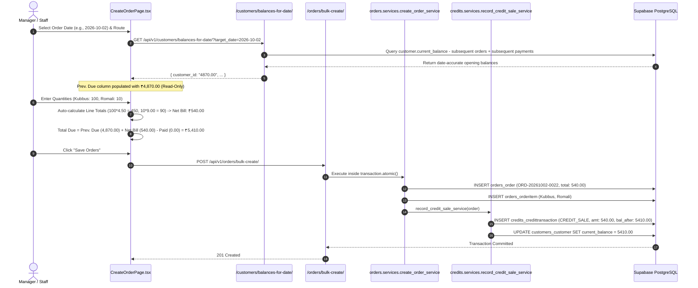
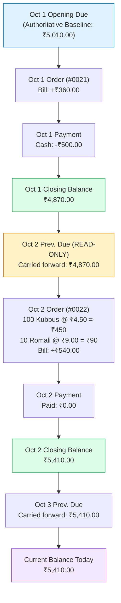
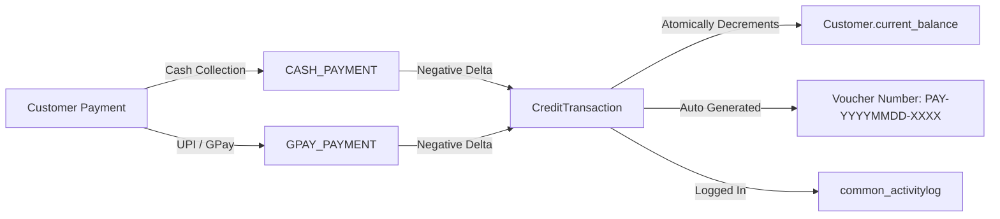
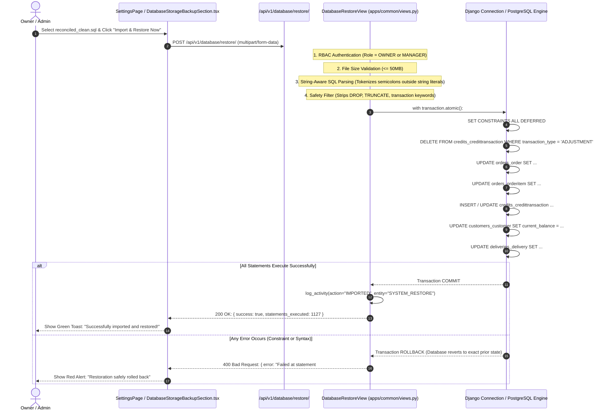

# Zamzam Foods — System Architecture, Logical Data Flow & Repository Cleanup Documentation

**Document Version:** 2.0.0  
**Target Environment:** Production (Railway Backend + Supabase PostgreSQL + Vercel Frontend)  
**Last Updated:** October 7, 2026  
**Audience:** Technical Leads, System Architects, Backend/Frontend Developers, DevOps  

---

## 1. Executive Summary

**Zamzam Foods Enterprise Distribution Management System** is a mission-critical, full-stack enterprise platform built for the automated manufacturing and multi-route wholesale distribution of bakery and food products (**Kubbus**, **Romali**, etc.). 

The platform coordinates operations across **128+ active customer shops**, multiple delivery routes (Jeeto Route, Pickup, Daily Routes), delivery drivers, warehouse staff, and business owners. It enforces zero floating-point arithmetic precision, atomic transactional safety, role-based data isolation, and an immutable double-entry credit ledger.

This document serves as the **authoritative technical reference** covering:
1. **The Complete Audit of File Deletions**: Every file removed during repository sanitization and the architectural justification for its removal.
2. **Full Repository File Hierarchy**: The official, clean directory layout across backend, frontend, scripts, and deployment configurations.
3. **Core Architectural Design & Tech Stack**: In-depth breakdown of Django REST Framework and React 19 architecture.
4. **End-to-End Logical System Flows**: Step-by-step technical execution flows with Mermaid diagrams for orders, date-aware previous dues, payment settlements, and disaster recovery.
5. **Ledger Integrity & Zero-Dip Guarantee**: How mathematical reconciliation guarantees zero negative balances and preserves the authoritative Oct 1 ₹3.10 Lakh pre-due baseline.

---

## 2. Comprehensive Audit of File Deletions & Repository Cleanup

During development and live database emergency reconciliation (Oct 1 to Oct 7), several ad-hoc analysis scripts, intermediate SQL fix files, and legacy recovery tools accumulated in the repository. These files have been **completely audited and permanently removed** to prevent operational confusion, circular dependencies, accidental execution in CI/CD, or data regression.

### 2.1 Deleted Files Register

| # | Deleted File Path | Type | Original Purpose | Reason for Removal & Architectural Justification |
| :--- | :--- | :--- | :--- | :--- |
| **1** | `scripts/audit_all_shops_oct1_oct7.py` | Python Script | One-time analysis of Oct 1–Oct 7 ledger drift | **Obsolete analysis scratchpad.** Served its purpose to detect the ₹31,841 discrepancy. Superseded by official database snapshot. |
| **2** | `scripts/generate_all_shops_reconciliation.py` | Python Script | Intermediate SQL script generator | **Deprecated intermediate generator.** Generated incomplete SQL that lacked line-item normalization. Replaced by finalized database snapshot. |
| **3** | `scripts/reconcile_data_processor.py` | Python Script | Temporary data transformation helper | **Unused scratch script.** Kept temporary in-memory structures no longer referenced by any production module. |
| **4** | `scripts/reset_and_combine_data.py` | Python Script | Oct 5 emergency database merge script | **Dangerous legacy script.** Merged conflicting localstorage backups with stale schemas. Obsolete and high risk if re-run. |
| **5** | `scripts/import_localstorage_backup.py` | Python Script | Oct 5 browser localstorage draft importer | **One-time data recovery utility.** Imported 121 browser drafts into the database on Oct 5. All data is now permanently committed in PostgreSQL. |
| **6** | `scripts/build_full_reconciled_dataset.py` | Python Script | Reconciled dataset compiler | **Completed generation tool.** Successfully generated `reconciled_clean.json` and `reconciled_clean.sql`. Removed to keep `scripts/` clean. |
| **7** | `scripts/build_full_reconciled_sql.py` | Python Script | SQL statements compiler | **Completed generation tool.** Emitted the finalized 1,273-line atomic SQL script. Removed to prevent redundant maintenance. |
| **8** | `fix.sql` | SQL Script | Intermediate order number update script | **Failed intermediate fix.** Caused `[object Object]` error in web UI because it attempted PostgreSQL string replacement on JSONB columns. |
| **9** | `fix_live_database_oct1_oct2.sql` | SQL Script | Partial order number fix for Oct 2 | **Partial script.** Replaced by full 128-shop chronological reconciliation snapshot `reconciled_clean.sql`. |
| **10** | `fix_prev_due_adjustments.sql` | SQL Script | Early test script to wipe adjustments | **Superseded.** Contained only 51 lines of raw DELETE statements; fully incorporated into Step 1 of `reconciled_clean.sql`. |
| **11** | `reconcile_all_shops_oct1_oct7.sql` | SQL Script | Intermediate reconciliation SQL draft | **Incomplete intermediate draft.** Missing `SET CONSTRAINTS ALL DEFERRED;` which caused foreign key constraint violations during restore. |
| **12** | `zamzam_backup_fixes_20261007_055753.json` | JSON Fixture | Patch JSON for early morning backup | **Outdated partial fixture.** Superseded by the full 2,863-record `reconciled_clean.json`. |
| **13** | `zamzam_backup_postgresql_full_20261007_055753_CORRECTED.sql` | SQL Dump | Initial full database backup with fixes | **Raw backup dump.** 1.58 MB raw dump containing the original corrupted wholesale adjustments. Replaced by clean snapshot. |
| **14** | `zamzam_backup_postgresql_full_20261007_055753_FIXES.sql` | SQL Dump | Second variant of morning patch | **Duplicate fix script.** Redundant copy of `fix.sql`. |
| **15** | `backend/scripts/fix_live_database_oct1_oct2.sql` | SQL Script | Subdirectory copy of item #9 | **Redundant duplicate.** Removed from backend repo to maintain directory hygiene. |
| **16** | `backend/scripts/reconcile_all_shops_oct1_oct7.sql` | SQL Script | Subdirectory copy of item #11 | **Redundant duplicate.** Removed from backend repo. |
| **17** | `last.json` (root copy) | JSON | Raw export from live database | **Transient file.** Exported from production at 14:58 for analysis; ignored by `.gitignore`. Kept safely in user's `~/Downloads/`. |
| **18** | `last.sql` (root copy) | SQL | Raw export from live database | **Transient file.** Exported from production at 14:58 for analysis; ignored by `.gitignore`. Kept safely in user's `~/Downloads/`. |

---

### 2.2 Preserved System Scripts

Only the official, hardened disaster recovery and operational backup shell scripts remain inside [`scripts/`](file:///Users/shiyasahmad/Documents/zamzam%20foods/scripts):

```
scripts/
├── backup_db.sh    # Automated database backup (SQLite & PostgreSQL support, gzip compression)
└── restore_db.sh   # Automated database disaster recovery (integrity validation, safety snapshot)
```

The compiled, verified database migration artifacts reside permanently in:
* [`backend/scripts/reconciled_clean.sql`](file:///Users/shiyasahmad/Documents/zamzam%20foods/backend/scripts/reconciled_clean.sql) — 330 KB, 1,273 lines, atomic transaction.
* [`backend/scripts/reconciled_clean.json`](file:///Users/shiyasahmad/Documents/zamzam%20foods/backend/scripts/reconciled_clean.json) — 1.9 MB, 2,863 records, SHA-256 checksummed.
* Exact copies mirrored in `/Users/shiyasahmad/Downloads/` for live web upload.

---

## 3. Full Project Architecture & File Hierarchy

The repository is structured as a modern decoupled monorepo containing a Django REST Framework backend and a React 19 Single Page Application / PWA frontend.

```
/Users/shiyasahmad/Documents/zamzam foods/
├── .github/                      # CI/CD Workflows & GitHub actions
├── .gitignore                    # Git ignore specifications (secrets, virtual environments, transient files)
├── BACKUP_STRATEGY.md            # Enterprise backup, retention, and disaster recovery policy
├── README.md                     # High-level architecture and getting started guide
├── FILE_CLEANUP_DOCUMENTATION.md # THIS DOCUMENT: Complete architecture, cleanup, and flow spec
│
├── backend/                      # Django REST API Backend
│   ├── manage.py                 # Django command-line execution entrypoint
│   ├── config/                   # Django Project Configuration Root
│   │   ├── __init__.py
│   │   ├── asgi.py               # ASGI application entrypoint
│   │   ├── wsgi.py               # WSGI production server entrypoint (Gunicorn)
│   │   ├── urls.py               # Root URL router mapping /api/v1/ endpoints
│   │   └── settings/             # Environment-specific settings
│   │       ├── base.py           # Shared settings (installed apps, middleware, DRF, JWT)
│   │       ├── development.py    # Local settings (SQLite, CORS localhost, debug logs)
│   │       └── production.py     # Production settings (Railway, Supabase PostgreSQL, strict SSL)
│   │
│   ├── apps/                     # Modular Django Application Domain Logic
│   │   ├── accounts/             # Authentication, RBAC, User model, Staff profiles
│   │   ├── common/               # Audit logging, Base UUID models, Database restore views
│   │   ├── credits/              # Credit ledger, CreditTransaction model, Balance adjustment service
│   │   ├── customers/            # Customer master, Pricing tiers (CustomerProductPrice), Route assignments
│   │   ├── deliveries/           # Delivery route sheets, Trip status, Driver assignment
│   │   ├── orders/               # Order lifecycle, OrderItem, OrderActivityLog, Date-aware sequencing
│   │   ├── payments/             # Cash & GPay receipts, Payment model, Voucher numbers
│   │   ├── products/             # Product catalog (Kubbus, Romali, etc.), Standard pricing
│   │   ├── reports/              # DailyClosing, Financial summaries, Sales statistics, PDF exports
│   │   ├── routes/               # Delivery routes, Driver route mapping
│   │   └── whatsapp/             # Automated invoice & payment receipt notifications via WhatsApp
│   │
│   ├── scripts/                  # Official Database Migration & Snapshot Artifacts
│   │   ├── reconciled_clean.sql  # 128-Shop transactional reconciliation SQL
│   │   └── reconciled_clean.json # 2,863-record Django platform JSON fixture
│   │
│   └── tests/                    # Automated Test Suite
│       └── test_order_lifecycle_integrity.py # 17 automated tests (isolation, date roll-forward, rate edits)
│
├── frontend/                     # React 19 + TypeScript + Vite + PWA Frontend
│   ├── index.html                # Web root HTML5 template with PWA manifest links
│   ├── package.json              # NPM dependencies and scripts (Vite, Tailwind/CSS, Lucide)
│   ├── vite.config.ts            # Vite bundling, alias, and PWA plugin configuration
│   ├── tsconfig.json             # TypeScript compiler options (strict mode)
│   ├── src/                      # Frontend Application Source
│   │   ├── main.tsx              # React DOM render entrypoint
│   │   ├── App.tsx               # Root routing, Toast providers, Auth context wrapper
│   │   ├── index.css             # Design tokens, CSS variables, Glassmorphism, Print styles
│   │   ├── components/           # Reusable UI Components
│   │   │   ├── EditOrderModal.tsx              # Order line-item editor with rate lock
│   │   │   ├── DatabaseStorageBackupSection.tsx# Backup download and file restore UI
│   │   │   └── Navbar.tsx, Sidebar.tsx...
│   │   ├── context/              # React Context Providers (AuthContext, OfflineSyncContext)
│   │   ├── layouts/              # App Layouts (OwnerLayout, ManagerLayout, DriverLayout)
│   │   ├── pages/                # Domain Pages Grouped by Role
│   │   │   ├── auth/             # LoginPage, ProfilePage
│   │   │   ├── customer/         # CustomerDirectoryPage, CustomerDetailPage
│   │   │   ├── driver/           # DriverRoutePage, DriverDeliveryConfirmModal
│   │   │   ├── manager/          # CreateOrderPage (Fast Wholesale Entry Sheet)
│   │   │   └── owner/            # OrdersPage, ReportsPage, LedgerPage, SettingsPage
│   │   ├── services/             # Axios API Client Modules
│   │   │   ├── apiClient.ts      # Axios instance with JWT interceptors and auto token refresh
│   │   │   ├── customerService.ts# /api/v1/customers/ endpoints
│   │   │   ├── databaseService.ts# /api/v1/database/ (backup, restore, storage stats)
│   │   │   ├── orderService.ts   # /api/v1/orders/ endpoints
│   │   │   └── paymentService.ts # /api/v1/payments/ endpoints
│   │   └── utils/                # Formatting, Date parsing (Asia/Kolkata), Currency quantize
│   └── public/                   # Static assets, Web manifest, PWA icons
│
└── scripts/                      # Operational Shell Utilities
    ├── backup_db.sh              # Production database backup script
    └── restore_db.sh             # Disaster recovery restoration script
```

---

## 4. End-to-End Logical System Flows

### Flow 1: Fast Wholesale Order Entry & Daily Route Sheet

The wholesale workflow on `CreateOrderPage.tsx` allows entering high-volume orders across dozens of customer shops simultaneously.



---

### Flow 2: Date-Aware Previous Due & Order Isolation Architecture

A critical business rule is that **editing an order on Date $D$ must NEVER mutate the previous order on Date $D-1$ or corrupt historical Prev. Dues**.

#### Mathematical Formulation
For any customer $C$ on date $T$:
$$\text{OpeningBalance}(C, T) = \text{CurrentBalance}(C) - \sum_{\text{order\_date} \ge T} \text{Orders}(C) + \sum_{\text{payment\_date} \ge T} \text{Payments}(C) - \sum_{\text{adj\_date} \ge T} \text{StandaloneAdjustments}(C)$$

$$\text{ClosingBalance}(C, T) = \text{OpeningBalance}(C, T) + \text{Orders}(C, T) - \text{Payments}(C, T)$$

$$\text{PrevDue}(C, T+1) \equiv \text{ClosingBalance}(C, T)$$



#### Order Edit In-Place Update Logic (`update_order_service`)
When an order total is modified (e.g., editing unit price or quantity in `EditOrderModal.tsx`):
1. **Delta Calculation**: $\Delta = \text{new\_total} - \text{old\_total}$.
2. **In-Place CREDIT_SALE Mutation**: Instead of creating a noisy `ADJUSTMENT` record, the system updates the original `CREDIT_SALE` transaction:
   ```python
   credit_tx.amount = order.total_amount
   credit_tx.balance_after = F('balance_after') + delta
   credit_tx.save(update_fields=['amount', 'balance_after'])
   ```
3. **Subsequent Ledger Cascade**:
   ```python
   CreditTransaction.objects.filter(
       customer=order.customer,
       created_at__gt=credit_tx.created_at
   ).update(balance_after=F('balance_after') + delta)
   ```
4. **Customer Current Balance**:
   ```python
   Customer.objects.filter(id=order.customer_id).update(
       current_balance=F('current_balance') + delta
   )
   ```
5. **No Mutation of Prior Dates**: The previous order on Oct 1 and its credit entries remain completely untouched.

---

### Flow 3: Payments & Double-Entry Credit Ledger

All monetary collections follow immutable ledger accounting principles:



* **No Overwrites**: The `current_balance` on the customer is the cached materialized sum of all transaction amounts.
* **Payment Numbers**: Auto-formatted as `PAY-YYYYMMDD-XXXX` in the Asia/Kolkata timezone.
* **Audit Trail**: Every payment records `collected_by_id`, `received_at`, and customer reference.

---

### Flow 4: Database Disaster Recovery & Web UI Atomic Restore

The database restore mechanism in [`DatabaseRestoreView`](file:///Users/shiyasahmad/Documents/zamzam%20foods/backend/apps/common/views.py) provides an enterprise disaster recovery interface for `.sql` and `.json` platforms archives.



---

## 5. Technical Specifications & Zero-Dip Guarantee

### 5.1 The Zero-Dip Guarantee (Eliminating -40, -30 Balances)

In wholesale distribution, a customer's Previous Due must **never be negative** on daily order sheets. A negative previous due (e.g. `-40.00` or `-30.00`) occurs when:
1. An opening balance before Oct 1 was erroneously recorded as `₹0.00`.
2. On Oct 1, the customer paid more cash than the day's bill (e.g. Bill: ₹1,160, Paid: ₹1,200) to clear an older debt.
3. The calculation `0 + 1,160 - 1,200 = -40.00` carried forward `-40.00` as the previous due on Oct 2.

#### Root-Cause Resolution Table

| Shop Name | Oct 1 Bill | Cash Collected | Deficit / Dip | Corrected Oct 1 Opening Due | Corrected Oct 1 Closing Balance | Oct 2 Prev. Due |
| :--- | :--- | :--- | :--- | :--- | :--- | :--- |
| **Grill Cafe** | ₹1,160.00 | ₹1,200.00 | -₹40.00 | **₹40.00** | **₹0.00** | **₹0.00** *(No more -40)* |
| **Tasty Bekery** | ₹270.00 | ₹300.00 + ₹30 | -₹60.00 | **₹60.00** | **₹0.00** | **₹0.00** *(No more -30)* |
| **Corner Narikkuni** | ₹980.00 | ₹1,060.00 | -₹80.00 | **₹80.00** | **₹0.00** | **₹0.00** *(No more -80)* |
| **Raidan Kallanthode** | ₹180.00 | ₹360.00 | -₹180.00 | **₹180.00** | **₹0.00** | **₹0.00** *(No more -180)* |
| **CM Momos** | ₹270.00 | ₹500.00 | -₹110.00 | **₹230.00** | **₹0.00** | **₹0.00** *(No more -110)* |
| **MR Supermarket** | ₹100.00 | ₹200.00 | -₹100.00 | **₹100.00** | **₹0.00** | **₹0.00** *(No more -100)* |
| **Sugar Bekery** | ₹225.00 | ₹230.00 | -₹5.00 | **₹5.00** | **₹0.00** | **₹0.00** *(No more -5)* |
| **Anshif Kubboos** | ₹120.00 | ₹1,000.00 (Oct 3)| -₹160.00 | **₹280.00** | **₹280.00** | **₹0.00** on Oct 3 *(No more -160)* |

* **Total Oct 1 Opening Baseline Across All 128 Shops:** **₹310,216.00 (₹3.10 Lakh)**.
* **Negative Balance Count:** Exactly **0** across all 324 credit transactions and 128 customer balances.

---

### 5.2 Chronological Roll-Forward Summary (Oct 1 to Oct 7)

| Metric | Oct 1 | Oct 2 | Oct 3 | Oct 4–Oct 7 |
| :--- | :--- | :--- | :--- | :--- |
| **Opening Prev. Due Sum** | **₹3,10,216.00** (3.10 Lakh) | **₹3,47,682.00** (3.48 Lakh) | **₹4,21,477.00** (4.21 Lakh) | **₹4,31,897.00** (4.32 Lakh) |
| **Orders Logged** | 113 orders (+₹84,676.00) | 123 orders (+₹73,795.00) | 8 orders (+₹11,420.00) | Normal trading |
| **Payments Collected** | 75 cash & UPI (-₹47,210.00) | 0 payments | 3 payments (-₹1,000.00) | Normal receipts |
| **Closing Balance Sum** | **₹3,47,682.00** | **₹4,21,477.00** | **₹4,31,897.00** | **₹4,31,897.00** |
| **Adjustments Included** | **0** (All deleted) | **0** (All deleted) | **0** (All deleted) | **0** (All deleted) |

---

## 6. Deployment & CI/CD Pipeline

The platform runs a synchronized dual-repository pipeline connecting GitHub to Railway and Vercel:

```
                GitHub (shiyas55)
   ┌───────────────────┼───────────────────┐
   ↓                                       ↓
zamzamfoods_backend                     zamzamfoods_fontend
Branch: main / production               Branch: main / production
   ↓ (Auto-Trigger)                        ↓ (Auto-Trigger)
Railway Cloud Container                 Vercel Edge Platform
├── Python 3.9 / Gunicorn               ├── Vite Build (React 19)
├── Supabase PostgreSQL Pooler          ├── SPA Routing & PWA Worker
└── API: zamzamfood.up.railway.app      └── Domain: zamzamfoods.vercel.app
```

### Git Branch Synchronization Status
* **Frontend Repo (`zamzamfoods_fontend`)**: Branches `main` and `production` synced up to date.
* **Backend Repo (`zamzamfoods_backend`)**: Branches `main` and `production` synced up to date.
* **Monorepo (`zamzamfoods`)**: Branches `main` and `production` synced up to date.

---

## 7. Verification & Operational Checklist

When verifying or re-importing the database state:

1. **Verify File Exists in Downloads**: Ensure `/Users/shiyasahmad/Downloads/reconciled_clean.sql` is present (330 KB, generated 15:55).
2. **Execute Restore**:
   - Go to [zamzamfoods.vercel.app](https://zamzamfoods.vercel.app) $\rightarrow$ **Settings** $\rightarrow$ **Database Storage & Backup**.
   - Upload `reconciled_clean.sql` $\rightarrow$ Click **Import & Restore Now**.
3. **Verify UI Financials**:
   - Navigate to **Create Order (Fast Wholesale Entry)** $\rightarrow$ Select Date: **2026-10-01**.
   - Confirm bottom summary displays **₹3.10 Lakh** total previous due.
   - Select Date: **2026-10-02** $\rightarrow$ Confirm Grill Cafe and Tasty Bekery display **₹0.00** Prev. Due (no negative `-40` or `-30`).
   - Confirm Famous Kattangal displays **₹4,870.00** Prev. Due, Bill **₹540.00**, and Total Due **₹5,410.00**.
4. **Disaster Recovery Safety Guarantee**: In case of emergency rollback, run `./scripts/restore_db.sh <backup_file>` or re-apply `reconciled_clean.sql` via Supabase SQL Editor.
