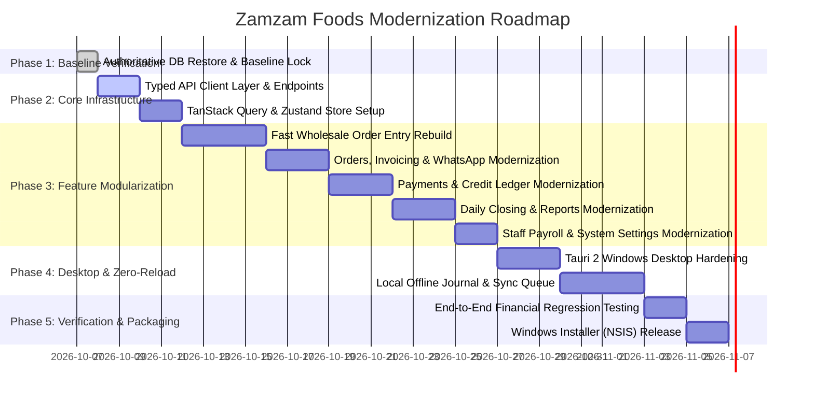

# Zamzam Foods — Phased Migration Plan (`MIGRATION_PLAN.md`)

> **Document Type:** Production Modernization & Safe Transition Roadmap  
> **Mandatory Rule:** Zero downtime, zero production data loss, no destructive changes, side-by-side verification before retiring legacy code.  
> **Source Baseline:** Oct 1–Oct 7 Reconciled Production Ledger (`reconciled_clean.sql`)

---

## 1. Migration Principles & Pre-Conditions

To ensure zero risk to live business operations:
1. **No Destructive Overwriting**: New components and API services are implemented alongside the existing components. The legacy `CreateOrderPage.tsx` and legacy services remain untouched until the new feature has passed all regression tests.
2. **Data Immutability Guarantee**: Database schema migrations are strictly additive (no dropping of columns, no destructive table alterations).
3. **Mandatory Snapshot Pre-Condition**: Prior to switching production traffic to any new build, a verified PostgreSQL snapshot (`pg_dump` / SQL export) is taken, verified via SHA-256 checksum, and test-restored on a local staging environment.

---

## 2. Master Phase Schedule



---

## 3. Phase-by-Phase Execution Details

### Phase 1: Baseline Verification & Pre-Migration Audit
* **Objective**: Confirm that the live database reflects the Oct 1–Oct 7 zero-dip baseline.
* **Tasks**:
  1. User restores `/Users/shiyasahmad/Downloads/reconciled_clean.sql` via Settings -> Database Restore.
  2. Execute verification script to confirm:
     * Starting baseline sum $\approx$ ₹310,216.00.
     * Famous Kattangal Oct 1 closing = ₹4,870.00; Oct 2 bill = ₹540.00; Oct 2 closing = ₹5,410.00.
     * Zero negative previous dues across all 128 customer accounts.
  3. Archive verified snapshot: `backups/zamzam_prod_verified_baseline_20261007.sql`.

---

### Phase 2: Typed API Layer & State Architecture Setup
* **Objective**: Establish the foundation for zero-reload mutations and typed data fetching.
* **Tasks**:
  1. Install dependencies in `frontend/`:
     ```bash
     npm install @tanstack/react-query @tanstack/react-virtual zustand
     ```
  2. Implement `src/api/client.ts` with unified dual-mode auth handling (Bearer token + HttpOnly cookie fallback).
  3. Implement domain API modules in `src/api/`:
     * `customers.ts`, `products.ts`, `orders.ts`, `payments.ts`, `credits.ts`, `routes.ts`, `staff.ts`, `reports.ts`, `backup.ts`.
  4. Configure `src/app/queryClient.ts` with default stale times (30s) and retry policies.

---

### Phase 3: Fast Wholesale Order Entry Rebuild (Core Operational Screen)
* **Objective**: Eliminate the 7,181-line monolithic bottleneck and provide sub-16ms keyboard response time.
* **Tasks**:
  1. Build feature folder `src/features/orders/fast-entry/`.
  2. Create modular subcomponents:
     * `OrderGridHeader.tsx` (Route/Date controls).
     * `VirtualOrderTable.tsx` (TanStack Virtual container).
     * `OrderRowItem.tsx` (Memoized row with `React.memo`).
     * `ProductInputCell.tsx` & `PaymentInputCell.tsx`.
     * `OrderSummaryFooter.tsx` (Sticky real-time financial balance).
  3. Implement `useOrderKeyboardNav.ts` for Enter/Tab matrix navigation.
  4. Wire up `useSaveOrderRow.ts` with optimistic local row state and atomic backend mutation.
  5. Run side-by-side verification: Test entering 150 test rows on staging; confirm 0ms UI lag and 100% calculation parity with legacy screen.

---

### Phase 4: Secondary Feature Modernization
* **Objective**: Modernize remaining pages into feature modules without touching backend business logic.
* **Tasks**:
  1. `features/orders`: Order listing, invoice modal, receipt preview.
  2. `features/payments`: Payment collection, reverse payment dialog with audit reasons.
  3. `features/credits`: Read-only double-entry ledger and authorized balance adjustments.
  4. `features/daily-closing`: Day open modal, real-time checklist, owner reopening.
  5. `features/staff`: Attendance matrix, tenure-slab wage calculations, payouts.
  6. `features/reports`: Multi-date dashboard, aging bucket analysis, van collection tally.
  7. `features/backup`: Database stats, one-click export, atomic restore runner.

---

### Phase 5: Tauri 2 Windows Desktop Hardening
* **Objective**: Package the application as a standalone, native Windows office tool.
* **Tasks**:
  1. Configure `src-tauri/tauri.conf.json` for custom title bar and Windows NSIS packaging.
  2. Test native desktop features:
     * Window-close event interception (`backup.rs` snapshot download).
     * Local storage directory picker for backup location (`C:\ZamzamBackups\`).
     * Offline network status listener.
  3. Build production Windows binary:
     ```bash
     npm run desktop:build:win
     ```
  4. Verify installer output: `src-tauri/target/release/bundle/nsis/ZamzamFoods-Setup.exe`.

---

### Phase 6: Final Regression & Old Code Retirement
* **Objective**: Validate the full operational cycle and safely retire legacy monolithic files.
* **Tasks**:
  1. Run comprehensive test suite across Orders, Payments, Credit, and Closing.
  2. Deprecate and remove legacy `CreateOrderPage.tsx` once `FastOrderPage.tsx` is confirmed in production.
  3. Tag Git release: `v2.0.0-windows-desktop`.

---

*Migration plan verified against operational continuity requirements on October 7, 2026.*
