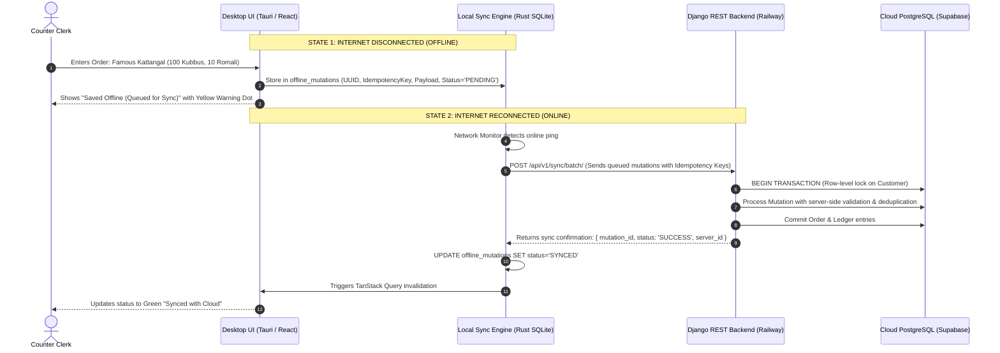

# Zamzam Foods — Synchronization & Offline Architecture (`SYNC_ARCHITECTURE.md`)

> **Document Type:** Multi-Computer Synchronization & Offline Resilience Specification  
> **Target Environment:** Multi-Device Windows Desktop (Counter PC, Back-Office PC, Delivery Driver PWA)  
> **Authoritative Arbiter:** Supabase PostgreSQL 15+ via Railway Django REST Backend

---

## 1. High-Level Multi-Computer Architecture

In commercial wholesale bakery distribution, operations often run simultaneously across multiple terminals:
* **Terminal 1 (Counter PC)**: Fast wholesale order entry and cash counter collections.
* **Terminal 2 (Back-Office PC)**: Inventory adjustments, customer KYC updates, staff attendance, and financial reporting.
* **Terminal 3 (Delivery Driver Handheld / PWA)**: Van delivery status updates and field collections.

```mermaid
graph TD
    subgraph Cloud Master (Authoritative Truth)
        Postgres[(PostgreSQL Primary DB)]
        Django[Django REST Backend]
        Postgres <--> Django
    end

    subgraph Terminal 1 (Counter PC)
        App1[Tauri Desktop App]
        Queue1[Local SQLite Mutation Queue]
        App1 <--> Queue1
    end

    subgraph Terminal 2 (Back-Office PC)
        App2[Tauri Desktop App]
        Queue2[Local SQLite Mutation Queue]
        App2 <--> Queue2
    end

    subgraph Terminal 3 (Driver Mobile PWA)
        PWA[Mobile Browser App]
        IDB[IndexedDB Mutation Queue]
        PWA <--> IDB
    end

    Queue1 -->|Sync Engine (Online)| Django
    Queue2 -->|Sync Engine (Online)| Django
    IDB -->|Sync Engine (Online)| Django
    Django -->|TanStack Polling / Invalidation| App1
    Django -->|TanStack Polling / Invalidation| App2
    Django -->|TanStack Polling / Invalidation| PWA
```

---

## 2. Local Database Evaluation: SQLite vs. Local PostgreSQL

To determine the optimal local engine for the Windows desktop client, both options were evaluated against concrete business criteria:

| Evaluation Criterion | Embedded SQLite 3 (Recommended) | Local PostgreSQL Instance | Architectural Verdict |
| :--- | :--- | :--- | :--- |
| **1. Reliability** | **Extremely High.** Zero external dependencies, single embedded C/Rust engine in app process. | Medium. Subject to Windows Service failures, TCP socket port exhaustion, OS permission issues. | **SQLite wins.** Immune to service stoppage. |
| **2. Multi-Device Sync** | **Clean decoupling.** Acts as local journal & read cache; sync happens over clean HTTP REST to cloud. | High friction. Syncing two independent PostgreSQL servers requires complex replication (BDR/logical). | **SQLite wins.** Eliminates distributed multi-master DBMS sync bugs. |
| **3. Backup Simplicity** | **Trivial.** Single `.db` file or SQL export copy; can be zipped and backed up instantly without locking. | Requires `pg_dump.exe`, PostgreSQL bin path on Windows, service authentication during dump. | **SQLite wins.** Painless desktop backup. |
| **4. Concurrency** | Single-writer, multi-reader WAL mode. Ideal for single-user desktop terminal UI. | Multi-user server engine. Overkill for a local single-workstation desktop application. | **SQLite wins.** Matches desktop client profile. |
| **5. Installation Complexity** | **Zero installation required.** Embedded directly inside Tauri binary (`rusqlite`). No installer steps. | Requires bundled PostgreSQL installer (~200MB+), service setup, silent password init, port 5432. | **SQLite wins.** 100% silent one-click setup. |
| **6. Windows Maintenance** | Single file in `%APPDATA%\ZamzamFoods\`. No Windows services, no registry clutter, no firewall rules. | Requires Windows Service monitoring, firewall permissions, antivirus whitelisting, upgrade patches. | **SQLite wins.** Zero IT intervention needed. |
| **7. Disaster Recovery** | Atomic WAL recovery on crash; corrupted cache can simply be re-seeded from cloud PostgreSQL. | Service corruptions on dirty shutdown require repair utilities, log replay, or manual DBA repair. | **SQLite wins.** Disposable cache & replayable journal. |
| **8. Performance** | In-process C-speed queries (< 1ms). Zero TCP socket latency or IPC network overhead. | IPC over localhost TCP socket (1–5ms overhead per query + connection handshake). | **SQLite wins.** Sub-millisecond desktop queries. |

> **Decision & Architectural Rule:**  
> The desktop application utilizes **embedded SQLite 3 (via Rust `rusqlite` / Tauri)** as the local offline journal and read-cache.  
> The **cloud PostgreSQL database** remains the authoritative master system of record. Local databases never overwrite the cloud master via bulk SQL replace.

---

## 3. The Offline-to-Online Synchronization Pipeline



---

## 4. Conflict Resolution & Concurrency Controls

### 4.1 Strict Invariant Against "Latest SQL File Wins"
> **CRITICAL RULE:**  
> SQL backup files (`.sql`) must **NEVER** be used as a routine synchronization mechanism between computers.  
> Overwriting a database with another terminal's backup snapshot destroys transactions recorded on the first terminal. SQL files are strictly reserved for complete disaster recovery.

### 4.2 Record-Level Conflict Strategies

| Entity Type | Conflict Scenario | Resolution Policy | Technical Implementation |
| :--- | :--- | :--- | :--- |
| **Customer Master** | PC 1 changes phone; PC 2 updates address. | **Last Write Wins (Field Level)** with optimistic locking. | Uses `updated_at` timestamp comparison. If conflict occurs, server merges non-conflicting fields. |
| **Sales Orders** | PC 1 creates order for Shop A; PC 2 simultaneously creates order for Shop A. | **Idempotent Merge / Sequencing.** | UUID primary keys generated by client; server prevents duplicate identical items submitted within 5 seconds; orders generate unique sequential order numbers (`ORD-YYYYMMDD-XXXX`). |
| **Daily Payments** | PC 1 logs Cash ₹500; PC 2 logs Cash ₹500 for the same customer on the same date. | **Idempotent Upsert via `sync_daily_payment`.** | The endpoint evaluates total cash received for the date rather than blind addition, preventing accidental payment doubling. |
| **Credit Ledger** | Concurrent mutations to customer balance. | **Server-Side Row Lock (`select_for_update`).** | Ledger transactions are strictly sequential. The database locks the `Customer` row, applies delta, and writes immutable `CreditTransaction` row with new `balance_after`. |
| **Daily Closing** | PC 1 submits closing; PC 2 attempts to edit an order after closing. | **Closed State Lockout.** | Server checks `DailyClosing.is_closed`. If True, modifications to that date's orders are rejected with `HTTP 400 Day is Closed`. Reopening requires Owner authorization. |

---

## 5. Offline Queue Schema (Local SQLite in Tauri)

```sql
CREATE TABLE IF NOT EXISTS offline_mutation_queue (
    id TEXT PRIMARY KEY,               -- Client-generated UUID
    idempotency_key TEXT UNIQUE,       -- SHA-256 of (user_id + endpoint + payload)
    endpoint TEXT NOT NULL,            -- e.g. "/api/v1/orders/"
    http_method TEXT NOT NULL,         -- POST, PUT, DELETE
    payload_json TEXT NOT NULL,        -- Serialized JSON request body
    created_at TIMESTAMP DEFAULT CURRENT_TIMESTAMP,
    status TEXT NOT NULL,              -- 'PENDING', 'SYNCING', 'SYNCED', 'FAILED'
    retry_count INTEGER DEFAULT 0,
    last_error TEXT,
    server_response_json TEXT
);

CREATE INDEX IF NOT EXISTS idx_mutation_status ON offline_mutation_queue(status);
```

---

*Specification verified against multi-device operational requirements on October 7, 2026.*
