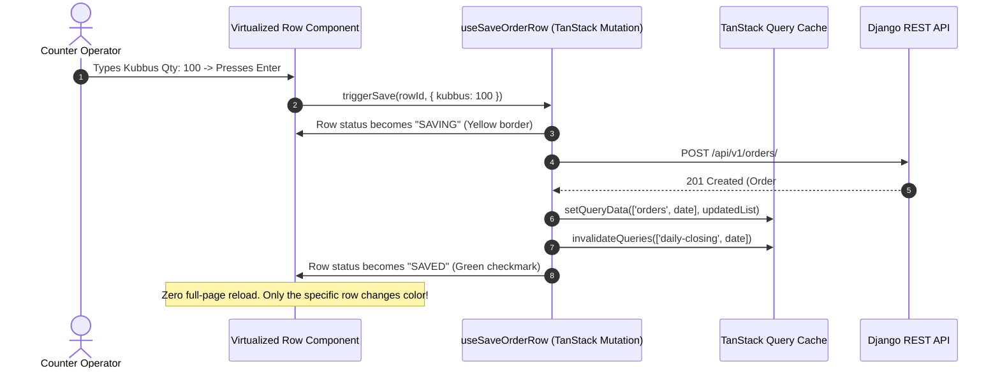

# Zamzam Foods — Target Architecture Specification (`TARGET_ARCHITECTURE.md`)

> **Document Type:** Target Production System Specification  
> **Platform Target:** Native Windows Desktop Application (Windows 10/11 x64, MSVC / WebView2) + Cloud Django REST + Supabase PostgreSQL  
> **Core Principles:** Native desktop responsiveness, zero full-page reloads, feature-based modularity, atomic ledger mutations, zero data loss.

---

## 1. System Vision & Target Architectural Diagram

The modernized Zamzam Foods system transforms the existing web application into a **high-performance, native Windows business application** powered by **Tauri 2**, while keeping the existing **Django REST Framework backend** and **PostgreSQL database** as the authoritative financial source of truth.

```mermaid
graph TD
    subgraph Windows Desktop Client (Tauri 2 Runtime)
        subgraph UI & State Layer
            ReactApp[React 19 + TypeScript + Vite 8]
            ZustandStore[Zustand Stores - UI & Workspace State]
            TanStackQuery[TanStack Query v5 - Server State Cache]
            VirtualTable[@tanstack/react-virtual - Windowed Order Grid]
        end

        subgraph Local Offline & Native Services
            TauriCore[Tauri 2 Rust Core Engine]
            LocalQueue[Offline Mutation Queue & SQLite Journal]
            PrinterService[Direct ESC/POS Thermal Printer Driver]
            NativeBackup[Background Backup Daemon - Rust Tokio]
        end
    end

    subgraph Cloud Infrastructure (Authoritative Backend)
        RailwayGunicorn[Railway Container - Gunicorn 3 Workers]
        DjangoREST[Django 4.2 REST Framework API]
        PostgresDB[(Supabase PostgreSQL 15+ Pooler)]
        CloudStorage[(Cloudinary / S3 Backup Mirror)]
    end

    ReactApp -->|Mutations / Queries| TanStackQuery
    ReactApp -->|UI State & Shortcuts| ZustandStore
    ReactApp -->|Virtualized Rows| VirtualTable
    TanStackQuery -->|IPC Invoke| TauriCore
    TauriCore -->|HTTPS + Bearer / Cookie| RailwayGunicorn
    TauriCore -->|Offline Write| LocalQueue
    TauriCore -->|USB / Raw Port| PrinterService
    TauriCore -->|Scheduled Daemon| NativeBackup
    RailwayGunicorn --> DjangoREST
    DjangoREST -->|ACID Transactions| PostgresDB
    DjangoREST -->|Snapshots| CloudStorage
```

---

## 2. Technology Stack & Responsibilities

| Architectural Layer | Target Technology | Key Role & Responsibilities |
| :--- | :--- | :--- |
| **Desktop Shell** | Tauri 2.10+ (Rust) | Lightweight native Windows window host (WebView2), direct USB/COM thermal printer access, background scheduled backup daemons, local file picker. |
| **Frontend Framework** | React 19.2+ (TypeScript) | UI view rendering, strict typing across all domain entities, keyboard event listeners. |
| **Server State Engine** | TanStack Query v5 (`@tanstack/react-query`) | Authoritative server state caching, background invalidation, optimistic updates, automatic retries with exponential backoff. |
| **Client State Engine** | Zustand v5 (`zustand`) | Ephemeral client-only UI state: active sidebar, modal triggers, keyboard focus index, selected date, table column preferences. |
| **Virtualization Engine** | TanStack Virtual (`@tanstack/react-virtual`) | DOM virtualization for 200+ customer shops in Fast Wholesale Entry, rendering only visible rows ($\approx 15\text{--}25$ DOM nodes instead of 1,800+). |
| **API Client** | Typed Fetch Client (`api/client.ts`) | Unified HTTP client with automatic JWT token refreshing, single-flight request coalescing, and network status monitoring. |
| **Backend API** | Existing Django 4.2 REST Framework | Business domain validation, row-level locking (`select_for_update`), ledger double-entry enforcement, reporting aggregations. |
| **Primary Database** | Existing Supabase PostgreSQL 15+ | Authoritative relational data store, ACID transactions, JSONB audit logging, automated point-in-time recovery. |

---

## 3. Modular Frontend Feature Architecture

The monolithic frontend is restructured into a clean, domain-driven feature-based hierarchy:

```
frontend/src/
├── app/                              # Application bootstrap & providers
│   ├── App.tsx                       # Root component with QueryClientProvider, Router, Theme
│   ├── main.tsx                      # DOM entry point
│   └── queryClient.ts                # Configured TanStack Query client with caching policies
│
├── api/                              # Typed API contracts & domain endpoints
│   ├── client.ts                     # Base fetch client with token refresh & retry logic
│   ├── auth.ts                       # Login, refresh, logout, sessions API
│   ├── customers.ts                  # Customer CRUD, price matrices, balances API
│   ├── products.ts                   # Products catalog API
│   ├── orders.ts                     # Orders CRUD, fast entry, locking API
│   ├── payments.ts                   # Payments sync, reverse, summaries API
│   ├── credits.ts                    # Credit ledger, authorized adjustments API
│   ├── routes.ts                     # Routes, drivers, shift stock API
│   ├── staff.ts                      # Staff profiles, attendance, payouts API
│   ├── reports.ts                    # Dashboard, closing, aging credit reports API
│   └── backup.ts                     # Database stats, export, import API
│
├── features/                         # Domain-driven feature modules
│   ├── auth/                         # Login form, session cards, permission checks
│   ├── customers/                    # Customer list, shop profile, document KYC uploader
│   ├── products/                     # Product catalog cards, rate adjustments
│   ├── orders/                       # Order history table, invoice modal, receipt printing
│   │   ├── fast-entry/               # REBUILT CREATE ORDER FEATURE
│   │   │   ├── FastOrderPage.tsx     # Master controller view
│   │   │   ├── components/
│   │   │   │   ├── OrderGridHeader.tsx     # Route picker, date picker, status summaries
│   │   │   │   ├── VirtualOrderTable.tsx   # Virtualized table container
│   │   │   │   ├── OrderRowItem.tsx        # Memoized single customer row (React.memo)
│   │   │   │   ├── ProductInputCell.tsx    # Keyboard-controlled quantity input
│   │   │   │   ├── PaymentInputCell.tsx    # Cash / GPay input with live closing due
│   │   │   │   ├── InlineCustomerModal.tsx # Quick-add new shop modal
│   │   │   │   ├── WhatsAppShareModal.tsx  # Direct WhatsApp receipt generator
│   │   │   │   └── OrderSummaryFooter.tsx  # Sticky bottom bar with totals
│   │   │   ├── hooks/
│   │   │   │   ├── useFastOrderGrid.ts     # Grid state and keyboard traversal
│   │   │   │   ├── useSaveOrderRow.ts      # Single-row mutation hook
│   │   │   │   └── useOrderKeyboardNav.ts  # Arrow & Enter key cell matrix jumper
│   │   │   └── store/
│   │   │       └── fastOrderStore.ts       # Grid UI state (search, filters, focused cell)
│   ├── payments/                     # Payment history, reversal dialog, daily tally
│   ├── credits/                      # Historical ledger table, authorized balance adjustments
│   ├── routes/                       # Delivery routes, driver vehicle assignments
│   ├── staff/                        # Staff master directory, attendance matrix, wage ledger
│   ├── daily-closing/                # Day open modal, daily checklist, owner reopen modal
│   ├── reports/                      # Dashboard cards, aging buckets, driver collections
│   └── backup/                       # Storage statistics, SQL/JSON exporter, restore runner
│
├── components/                       # Shared design system components
│   ├── ui/                           # Button, Input, Modal, Badge, Card, Spinner, Dropdown
│   ├── forms/                        # FormField, Select, CurrencyInput, DatePicker
│   ├── feedback/                     # ToastNotifications, ConfirmDialog, ErrorAlert
│   └── layout/                       # WindowTitleBar, Sidebar, AppHeader, PageContainer
│
├── stores/                           # Lightweight Zustand client stores
│   ├── uiStore.ts                    # Sidebar collapse, active theme, fullscreen
│   └── filterStore.ts                # Persisted route selections and search query
│
├── types/                            # Core TypeScript models and API schemas
└── utils/                            # Financial formatters, dates, WhatsApp text generators
```

---

## 4. Zero-Reload Architecture Specification

### 4.1 Strict Operational Invariant
> **Rule:** `window.location.reload()` is completely eliminated from all application paths.  
> Every user interaction operates through **optimistic UI updates $\rightarrow$ server mutation $\rightarrow$ cache invalidation $\rightarrow$ instant DOM patch**.



---

## 5. Rebuilt Fast Wholesale Order Grid Specification

### 5.1 Keyboard Traversal Matrix
The new `useOrderKeyboardNav` hook manages a 2D coordinate system: `(rowIndex, colIndex)`.
* **Enter Key**: Saves current row asynchronously and advances cursor immediately to the same product column in the next customer row (`(row + 1, col)`).
* **Tab / Shift+Tab**: Moves horizontally between product columns (`Kubbus -> Romali -> Cash -> GPay -> Discount`).
* **Arrow Up / Down**: Moves vertically without changing the product column.
* **Escape**: Cancels cell edit and reverts to current saved value.

### 5.2 Performance & Memoization Guarantee
* **Row Isolation**: `OrderRowItem` is wrapped in `React.memo` with a custom equality function:
  ```typescript
  export const OrderRowItem = React.memo(OrderRowComponent, (prev, next) => {
    return (
      prev.row.kubbusQty === next.row.kubbusQty &&
      prev.row.romaliQty === next.row.romaliQty &&
      prev.row.cashAmount === next.row.cashAmount &&
      prev.row.gpayAmount === next.row.gpayAmount &&
      prev.row.discountAmount === next.row.discountAmount &&
      prev.row.status === next.row.status &&
      prev.isFocused === next.isFocused
    );
  });
  ```
* **Result**: Typing in row #12 causes **exactly 1 row to re-render**. The other 149 rows do NOT execute render cycles.

---

## 6. Multi-Computer Workflow & Concurrency Management

In a multi-computer warehouse/counter setup (e.g. Counter PC 1 + Warehouse PC 2 + Mobile Driver):
1. **Cloud PostgreSQL as Authoritative Arbiter**: Both PC 1 and PC 2 connect to the central Django REST API.
2. **Optimistic Concurrency & Row Locking**:
   * Order saves use `select_for_update()` in Django to prevent balance races.
   * Daily payments use the idempotent `sync_daily_payment` endpoint.
3. **TanStack Background Polling / Invalidation**:
   * Stale time is set to 30 seconds.
   * Window focus triggers a lightweight background query refetch (`refetchOnWindowFocus: true`), automatically syncing orders entered by other machines.
4. **No "Latest SQL File Wins"**: SQL backup files are strictly reserved for disaster recovery and are never used as a daily synchronization vehicle between computers.

---

## 7. Windows Desktop Integration (Tauri 2)

### 7.1 Native Capabilities
1. **Window Management**: Custom native title bar with Windows 11 snap layouts, minimize, maximize, and close buttons.
2. **Direct Thermal Printing**: Bypass browser print dialogs using native USB/ESC-POS commands directly to thermal receipt printers (58mm / 80mm).
3. **Automated Window-Close Backup**: On window close (`CloseRequested`), Tauri Rust intercepts the event, downloads the latest verified SQL snapshot, writes it with atomic renaming (`.tmp -> .sql`), and calculates SHA-256 checksums before closing the window.

---

*Specification verified against project objectives on October 7, 2026.*
