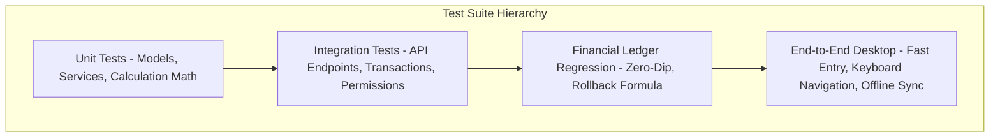

# Zamzam Foods — Comprehensive Quality & Test Plan (`TEST_PLAN.md`)

> **Document Type:** Quality Assurance & Automated Test Suite Specification  
> **Mandatory Rule:** 100% test pass rate across financial calculations, ledger integrity, and concurrency controls prior to production release.  
> **Test Frameworks:** Python `pytest` + `pytest-django` (Backend) / TypeScript `vitest` + React Testing Library (Frontend)

---

## 1. Test Architecture & Coverage Matrix



---

## 2. Detailed Test Case Specifications

### 2.1 Customer & Custom Pricing Tests (`tests/test_customers.py`)
* **TC-CUST-01: Customer Creation & Initial Balance**
  * *Input*: Create customer "Test Supermarket", route "Pandikkad", credit limit ₹5,000.
  * *Expected*: Customer saved with `current_balance = 0.00`, `is_active = True`.
* **TC-CUST-02: Route Change & Driver Cascading**
  * *Input*: Change customer route from Pandikkad to Melattur.
  * *Expected*: Customer updated; historical orders retain original assigned route; subsequent orders assign Melattur's driver.
* **TC-CUST-03: Custom Pricing Resolution**
  * *Input*: Kubbus standard price = ₹5.00. Set custom price for Shop A = ₹4.50.
  * *Expected*: Order for Shop A resolves Kubbus @ ₹4.50; order for Shop B resolves Kubbus @ ₹5.00.
* **TC-CUST-04: Custom Price Expiry & Fallback**
  * *Input*: Custom price effective until yesterday.
  * *Expected*: Today's order falls back to standard catalog price ₹5.00.

---

### 2.2 Orders & Calculation Tests (`tests/test_orders.py`)
* **TC-ORD-01: Line Item Calculation & Order Total**
  * *Input*: 100 Kubbus @ ₹4.50 (= ₹450), 10 Romali @ ₹9.00 (= ₹90), Shop Expense = ₹20.
  * *Expected*: `subtotal = ₹540.00`, `total_amount = max(0, 540 - 20) = ₹520.00`.
* **TC-ORD-02: Double-Submit / Idempotency Protection**
  * *Input*: Submit identical order payload twice within 2 seconds.
  * *Expected*: Exactly 1 order created in database; second call returns existing order object without duplicating ledger debit.
* **TC-ORD-03: Order In-Place Edit & Ledger Sync**
  * *Input*: Edit Order from ₹520.00 to ₹550.00 (Delta = +₹30.00).
  * *Expected*: Customer `current_balance` increases by ₹30.00; existing `CREDIT_SALE` entry updated in-place to ₹550.00; zero `ADJUSTMENT` transactions created.
* **TC-ORD-04: Order Deletion Balance Restoration (Owner Only)**
  * *Input*: Delete Order totaling ₹520.00.
  * *Expected*: Customer `current_balance` decreases by ₹520.00; `ADJUSTMENT` ledger entry logged with negative amount; Order deleted.

---

### 2.3 Payments & Reversal Tests (`tests/test_payments.py`)
* **TC-PAY-01: Fast Daily Payment Sync (`sync_daily_payment`)**
  * *Input*: Call `sync_daily_payment` with Cash = ₹1,000.00 on Date D.
  * *Expected*: Payment record created for ₹1,000.00; customer balance reduced by ₹1,000.00; credit ledger records `CASH_PAYMENT` (-₹1,000.00).
* **TC-PAY-02: Payment Sync In-Place Adjustment**
  * *Input*: Call `sync_daily_payment` again on Date D with Cash changed to ₹800.00 (User corrected counter typo).
  * *Expected*: Primary Payment updated to ₹800.00; customer balance adjusted by +₹200.00; exactly 1 Payment row exists for that date and method.
* **TC-PAY-03: Payment Sync Clear to Zero**
  * *Input*: Call `sync_daily_payment` with Cash = ₹0.00.
  * *Expected*: Existing payment deleted; ledger entry deleted; customer balance restored by original amount.
* **TC-PAY-04: Mandatory Reversal Reason & Immutability**
  * *Input*: Send `DELETE /api/v1/payments/:id/`.
  * *Expected*: HTTP 405 Method Not Allowed.
  * *Input*: Send `POST /api/v1/payments/:id/reverse/` with `reason = "Counter duplicate entry"`.
  * *Expected*: Payment marked `REVERSED`; customer balance restored (+amount); `PAYMENT_REVERSAL` ledger transaction logged.

---

### 2.4 Credit Ledger & Historical Rollback Tests (`tests/test_credits.py`)
* **TC-CR-01: Double-Entry Balance Invariant**
  * *Assertion*: For every customer account, `current_balance` must exactly equal `sum(CreditTransaction.amount)`.
* **TC-CR-02: Dynamic Historical Opening Due Rollback Formula**
  * *Setup*:
    * Day 1: Starting Balance = ₹5,000.00. Order = ₹400.00. Cash Paid = ₹500.00. Closing = ₹4,900.00.
    * Day 2: Order = ₹600.00. Cash Paid = ₹400.00. Closing = ₹5,100.00.
  * *Test*: Query `get_customers_opening_balances_for_date("Day 2")`.
  * *Formula*:
    $$\text{Opening Due} = \text{Current Balance (5,100)} - \text{Day 2 Order (600)} + \text{Day 2 Payment (400)} = \text{₹4,900.00}$$
  * *Expected*: Returned balance strictly matches Day 1 closing: **₹4,900.00**.
* **TC-CR-03: Zero-Dip Invariant Test**
  * *Input*: Customer pays down older debt (Payment > Today's Order).
  * *Expected*: Rollback engine returns $\ge 0.00$; zero negative dues (`-40`, `-30`) are displayed.

---

### 2.5 Daily Closing & Day Open Tests (`tests/test_reports.py`)
* **TC-CLS-01: Day Open Register Float**
  * *Input*: Post `daily-open` with `opening_cash = ₹500.00`.
  * *Expected*: `DailyClosing` created with `is_opened = True`, `opening_cash = 500.00`.
* **TC-CLS-02: Expected Cash in Hand Formula Verification**
  * *Input*: Opening Cash = ₹500, Cash Collected = ₹30,000, Driver Expenses = ₹1,500, Staff Cash Payouts = ₹2,000.
  * *Expected*:
    $$\text{Expected Cash} = 500 + 30,000 - 1,500 - 2,000 = \text{₹27,000.00}$$
* **TC-CLS-03: Closed Day Lockout & Owner Reopen**
  * *Input*: Manager closes day. Then attempts to create or edit an order for that date.
  * *Expected*: API rejects order edit with HTTP 400.
  * *Input*: Owner calls `daily-closing/reopen/` with valid reason.
  * *Expected*: Day status becomes `is_closed = False`; order edits re-enabled; reopening audit logged.

---

### 2.6 Offline Queueing & Reconnection Tests (`frontend/tests/sync.test.ts`)
* **TC-SYNC-01: Offline Mutation Journaling**
  * *Input*: Dispatch order creation while `navigator.onLine = false`.
  * *Expected*: Mutation stored in local SQLite queue with `status = 'PENDING'`; UI indicates queued state.
* **TC-SYNC-02: Network Reconnection Flush**
  * *Input*: Trigger `window.dispatchEvent(new Event('online'))`.
  * *Expected*: Sync worker sends queued mutations with idempotency keys; server confirms 201; local queue marks `status = 'SYNCED'`.

---

## 3. Automated Test Execution Commands

```bash
# 1. Execute full backend Django test suite
cd backend
python manage.py test tests/ --verbosity=2

# 2. Execute pytest with coverage reporting
pytest --cov=apps --cov-report=term-missing

# 3. Execute frontend unit & component tests
cd ../frontend
npm run test:run

# 4. Verify TypeScript strict compliance
npm run build
```

---

*Test plan verified against enterprise audit standards on October 7, 2026.*
