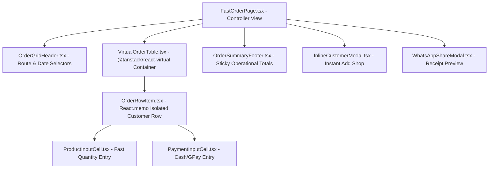

# Zamzam Foods — UI Architecture & Design Specification (`UI_ARCHITECTURE.md`)

> **Document Type:** Desktop User Interface & Interaction Specification  
> **Target UX:** Native Windows Professional Business Application (Windows 11 Fluent / Compact Enterprise Theme)  
> **Key Objective:** Sub-16ms response time, zero full-page reloads, virtualized rendering for 200+ customer shops

---

## 1. Native Windows Desktop Shell & Layout

The desktop application presents a clean, compact, and high-density interface tailored for rapid keyboard data entry and clear financial legibility.

```
┌────────────────────────────────────────────────────────────────────────────────────────┐
│ [Z] Zamzam Foods Wholesale Distribution — Enterprise Desktop            [-][□][X]      │
├──────────────────┬─────────────────────────────────────────────────────────────────────┤
│ (Search Ctrl+K)  │  Route: [All Routes ▼]   Date: [Today (Oct 2, 2026) 📅]   Status: 🟢│
├──────────────────┼─────────────────────────────────────────────────────────────────────┤
│ 📊 Dashboard     │                                                                     │
│ 📝 Create Order  │                        MAIN WORKSPACE                               │
│ 📦 Orders List   │                   (Virtualized Grid / Views)                        │
│ 🏪 Customers     │                                                                     │
│ 🍞 Products      │                                                                     │
│ 💳 Payments      │                                                                     │
│ 📜 Credit Ledger │                                                                     │
│ 🚚 Routes & Van  │                                                                     │
│ 👥 Staff & Wages │                                                                     │
│ 📈 Reports       │                                                                     │
│ 🔒 Daily Closing │                                                                     │
│ 💾 DB Backup     │                                                                     │
│ ⚙️ Settings      │                                                                     │
├──────────────────┴─────────────────────────────────────────────────────────────────────┤
│ Total Orders: 84 | Gross Sales: ₹46,250.00 | Cash: ₹31,200 | UPI: ₹7,200 | Balance: ₹3.10L│
└────────────────────────────────────────────────────────────────────────────────────────┘
```

### 1.1 Custom Native Title Bar
* Implemented via Tauri's window decorations override (`decorations: false` in `tauri.conf.json`).
* Features custom Windows 11 style minimize, maximize/restore, and close buttons.
* Includes draggable region (`data-tauri-drag-region`) across the top header.
* Shows live connection indicator: 🟢 **Online (Supabase Connected)** or 🟡 **Offline (Local Journal Mode)**.

---

## 2. Deconstruction of the 7,181-Line `CreateOrderPage.tsx`

The monolithic file `CreateOrderPage.tsx` is completely decommissioned and replaced by a modular component hierarchy in `src/features/orders/fast-entry/`:



### 2.1 Component Breakdown & Responsibilities

| Component File | Lines (Est.) | Primary Responsibility & Performance Contract |
| :--- | :--- | :--- |
| `FastOrderPage.tsx` | $\approx 250$ | Top-level feature container. Connects TanStack Query hooks, manages route/date filter state, coordinates keyboard shortcuts. |
| `OrderGridHeader.tsx` | $\approx 180$ | Quick route dropdown selector, date picker, fast search input, batch action buttons (Print Route Sheet, Day Open banner). |
| `VirtualOrderTable.tsx` | $\approx 200$ | Container wrapping `@tanstack/react-virtual`. Dynamically computes container height and renders only visible row nodes. |
| `OrderRowItem.tsx` | $\approx 220$ | **Memoized single customer row (`React.memo`)**. Computes subtotal and net due for one shop only. Isolates re-renders to the currently edited shop. |
| `ProductInputCell.tsx` | $\approx 110$ | Quantity input component for Kubbus, Romali, etc. Intercepts Enter, Tab, Arrow keys and passes coordinate jumps to the keyboard navigator. |
| `PaymentInputCell.tsx` | $\approx 120$ | Cash and GPay collection input with auto-formatting and live closing balance calculation. |
| `OrderSummaryFooter.tsx` | $\approx 150$ | Sticky bottom footer summarizing total Kubbus pieces, Romali pieces, cash collected, UPI collected, and total previous due. |
| `InlineCustomerModal.tsx` | $\approx 160$ | Lightweight dialog allowing instant creation of a new customer shop without leaving the order entry screen. |
| `WhatsAppShareModal.tsx` | $\approx 140$ | Formats verified invoice and payment receipts for direct delivery via WhatsApp Web or Cloud API. |

---

## 3. Keyboard-First Navigation Matrix

To ensure warehouse billing staff can enter 150+ customer bills in under 10 minutes without touching a mouse:

```
[Row 1: Famous Kattangal] -> [Kubbus (100)] ===Tab===> [Romali (10)] ===Tab===> [Cash (500)]
                                  │
                                Enter
                                  ▼
[Row 2: Grill Cafe] -------> [Kubbus (50)]  ===Tab===> [Romali (0)]  ===Tab===> [Cash (1,200)]
                                  │
                                Enter
                                  ▼
[Row 3: Tasty Bekery] -----> [Kubbus (30)]  ===Tab===> [Romali (15)] ===Tab===> [Cash (330)]
```

### 3.1 Keyboard Actions
* **Enter**: Validates current cell, triggers asynchronous background save mutation, and moves focus to the same product column in the row below (`(r + 1, c)`).
* **Tab / Shift+Tab**: Advances focus horizontally between input cells within the same row.
* **Arrow Up / Arrow Down**: Traverses vertically between rows while maintaining cursor selection.
* **Ctrl + F / Ctrl + K**: Focuses quick customer search input.
* **Ctrl + P**: Triggers direct thermal printing of current route delivery summary.

---

## 4. Virtualization Engine Integration (`@tanstack/react-virtual`)

```tsx
import { useVirtualizer } from '@tanstack/react-virtual';

export const VirtualOrderTable: React.FC<{ rows: OrderRowData[] }> = ({ rows }) => {
  const parentRef = React.useRef<HTMLDivElement>(null);

  const rowVirtualizer = useVirtualizer({
    count: rows.length,
    getScrollElement: () => parentRef.current,
    estimateSize: () => 48, // 48px compact row height
    overscan: 5,           // Pre-render 5 rows above and below viewport
  });

  return (
    <div ref={parentRef} className="virtual-table-viewport">
      <div style={{ height: `${rowVirtualizer.getTotalSize()}px`, position: 'relative' }}>
        {rowVirtualizer.getVirtualItems().map((virtualRow) => {
          const rowData = rows[virtualRow.index];
          return (
            <div
              key={rowData.customerId}
              style={{
                position: 'absolute',
                top: 0,
                left: 0,
                width: '100%',
                height: `${virtualRow.size}px`,
                transform: `translateY(${virtualRow.start}px)`,
              }}
            >
              <OrderRowItem row={rowData} index={virtualRow.index} />
            </div>
          );
        })}
      </div>
    </div>
  );
};
```

* **Impact**: Total DOM nodes rendered at any instant drops from **over 1,800 elements to approximately 180 elements**, eliminating all input lag.

---

## 5. Design System Tokens & Themes

The application uses crisp custom CSS custom properties defined in `src/styles/tokens.css`:

```css
:root {
  /* Zamzam Foods Professional Enterprise Palette */
  --brand-primary: #b91c1c;       /* Deep Crimson */
  --brand-primary-hover: #991b1b;
  --brand-accent: #d97706;        /* Golden Amber */
  --bg-app: #f1f5f9;              /* Neutral Slate */
  --bg-surface: #ffffff;          /* Card / Table Surface */
  --text-main: #0f172a;           /* Crisp Black */
  --text-muted: #64748b;          /* Secondary Gray */
  --border-ui: #cbd5e1;           /* Crisp Divider */
  --status-saved: #16a34a;        /* Emerald Success */
  --status-pending: #d97706;      /* Amber Saving */
  --status-error: #dc2626;        /* Rose Red Error */
  
  /* Dense Typography */
  --font-family: 'Segoe UI', -apple-system, BlinkMacSystemFont, sans-serif;
  --font-size-sm: 0.8125rem;      /* 13px */
  --font-size-base: 0.875rem;     /* 14px */
  --font-size-lg: 1.125rem;       /* 18px */
}

[data-theme='dark'] {
  --bg-app: #0f172a;
  --bg-surface: #1e293b;
  --text-main: #f8fafc;
  --text-muted: #94a3b8;
  --border-ui: #334155;
}
```

---

*Specification verified against UI performance requirements on October 7, 2026.*
